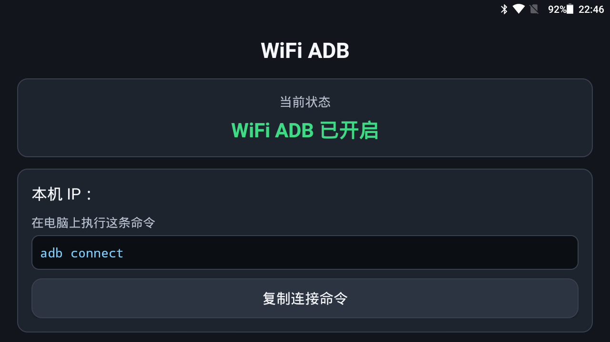

# 小墨机器人 WiFi ADB

为小墨机器人（Android 5.1 定制 ROM）提供**设备端一键开关 WiFi ADB** 的能力。

在机器人桌面点一下 App，即可开启或关闭无线调试；电脑上随后用
`adb connect <设备IP>:5555` 连接，之后拔掉 USB 数据线也不影响调试。

> **说明**：本仓库已做设备信息脱敏，不含真实设备序列号、型号、SoC 与内网 IP。
> 文中 `<设备IP>`、`<设备型号>`、`<SoC型号>` 等均为占位符，
> 请替换为你自己的设备信息。



## 快速开始

### 电脑端

```bash
adb connect <设备IP>:5555
adb devices        # 出现 <设备IP>:5555  device 即成功
```

### 设备端

桌面打开「**WiFi ADB**」App：

- 绿色按钮「开启 WIFI ADB」→ 开启无线调试
- 红色按钮「关闭 WIFI ADB」→ 关闭（用完建议关闭，尤其连公共 WiFi 时）
- 勾选「设备重启后自动保持 WiFi ADB」→ 重启后自动恢复，无需再插 USB

## 构建与安装

```bash
./gradlew assembleDebug
adb install -r app/build/outputs/apk/debug/app-debug.apk
```

首次构建需要本机已安装 Android SDK，并在 `local.properties` 中指定路径：

```properties
sdk.dir=D\:\\path\\to\\Android\\SDK
```

也可以改用环境变量 `ANDROID_HOME`，此时无需 `local.properties`。

## 脚本工具

| 脚本 | 用途 |
|---|---|
| `scripts/verify.sh` | 自检：设备连接、adbd 状态、App 安装、端口监听 |
| `scripts/recover.sh` | 命令行开关 WiFi ADB（`on` / `usb` / `status`） |
| `scripts/setup-autostart.sh` | 部署开机自启（写入 `persist.adb.tcp.port`） |

脚本会自动探测 adb 位置，也可通过环境变量指定：

```bash
DEVICE_IP=<设备IP> ADB_PORT=5555 ADB=/path/to/adb ./scripts/verify.sh
```

## 项目结构

```
.
├── app/                              # App 模块
│   └── src/main/
│       ├── java/com/workbuddy/wifiadb/
│       │   ├── MainActivity.java     # 界面逻辑
│       │   ├── WifiAdbController.java# 核心：命令执行、属性读写、端口校验
│       │   └── BootReceiver.java     # 开机自启
│       └── res/                      # 布局与配色
├── docs/
│   ├── README.md                     # 完整技术文档：实测结论、踩坑记录
│   └── screenshot.png                # 真机界面截图
├── scripts/                          # 电脑端辅助脚本
├── gradle/wrapper/                   # Gradle Wrapper
└── build.gradle.kts / settings.gradle.kts
```

## 技术要点

该设备为深度定制 ROM，有几处与标准 AOSP 不同的行为，直接决定了实现方式：

1. **不能靠 `su` 提权** —— su 是 AOSP 原版 `ALLOW_SHELL` 模式，硬编码只放行
   uid 0 / 2000，普通 App 调用会被拒（`su: uid <app-uid> not allowed to su`），
   放宽文件权限也无效（su 内部还有 uid 白名单）。
2. **改走 init 的 `ctl.*` 通道** —— SELinux 为 Disabled 且 App 进程自带 `adb` 组
   (gid 1011)，因此 App 可直接执行：
   ```bash
   setprop service.adb.tcp.port 5555
   setprop ctl.stop adbd
   setprop ctl.start adbd
   ```
3. **`ctl.stop` 与 `ctl.start` 必须分成两条命令** —— stop 之后 adbd 立刻退出，
   若两条写在同一条命令里，start 将永远送不出去。
4. **App 进程不依赖 adbd 存活** —— 这是 App 方案相对命令行方案的真正优势：
   命令行下 `ctl.start` 无法经 `adb shell` 投递（投递通道正是被停掉的 adbd），
   但 App 在设备本地执行，可以完成完整闭环。

更多实测细节与踩坑记录见 [docs/README.md](docs/README.md)。

## 安全提醒

设备 root 权限无授权校验（`su` 直接放行给 shell），SELinux 也是 Disabled 状态。
WiFi ADB 开启后，同网段任意主机均可连接调试。设备接入公共 WiFi 时，
建议用完立即在 App 中关闭 WiFi ADB。
